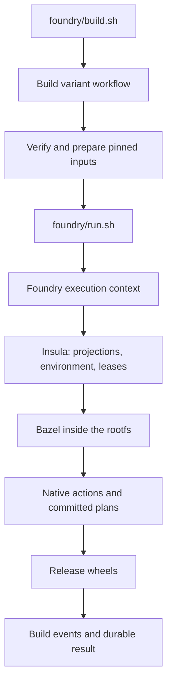

# A guided tour of the code

Start with the operation you want to understand. Vaso has two product modules:
**insula** constructs a process filesystem and runs a command in it; **Foundry**
chooses and builds native packages inside that filesystem. Host orchestration
selects paths and records results. Build tools and dependencies resolve inside
the insula rootfs.

For commands to run, use the [operator guide](operator-guide.md). This tour
connects those commands to their implementation. The [architecture](architecture.md)
defines module contracts; the [glossary](../GLOSSARY.md) defines the terms.

## Follow a generic command

For `insula/execution/insula.sh --rootfs DIR --workspace PROJECT -- COMMAND`,
start in [insula.sh](../insula/execution/insula.sh):

1. `insula_main` parses the command, rootfs, workspace, and execution phase.
   `--line` selects a prepared estate rootfs; `--rootfs` supplies an explicit base.
2. `insula_prepare_context` checks the base shell and workspace, then asks
   [estate.py](../insula/estate/estate.py) to validate and materialize the explicit
   estate. This creates backing directories, not toolchains or package inputs.
3. [overlay_root.py](../insula/estate/overlay_root.py) plans read-only base binds
   and writable mountpoint scaffolding. The context supplies the project,
   persistent state, home, prepared tools, environment, and working directory.
   Namespace and overlay planning failures stop preparation.
4. `insula` runs readiness checks through `insula_preflight`, then
   `insula_build_argv` assembles the Bubblewrap request. `--print-argv` prints
   that request and skips preflight and execution; context preparation still runs.
5. Normal execution starts the command with the prepared request and returns
   its status. Fetch execution requires an explicit hash pin and obtains a
   network-fetch lease. The caller owns other shared-resource reservations.

| Change | Owner | Relevant host tests |
|---|---|---|
| Estate directories or placement | `insula/estate/estate.py` | `estate_test.py` |
| Base overlay or namespace-to-host translation | `insula/estate/overlay_root.py`, `path_map.py` | `overlay_root_test.py`, `path_map_test.py` |
| Context preparation or command execution | `insula/execution/insula.sh` | `context_test.py`, `insula_entrypoint_test.py`, `planning_failure_test.py` |
| Resource reservation | `insula/execution/lease.py` | `insula_lease_test.py` |

Tests sit beside their owner. The Python package under `insula/execution/vaso/`
supplies readiness checks and a legacy host-layout planning CLI. Its
`BwrapPlan` scaffold does not execute the standalone shell launcher's request.
For execution options and caller-supplied contexts, use the [insula guide](insula.md).

## Follow one build

With a prepared estate, `foundry/build.sh --line cu129 --profile torch` builds
the Torch family and Triton. Read the path in this order:



1. [build.sh](../foundry/build.sh) forwards arguments to
   [build_variants.py](../foundry/tools/build_variants.py). Start at `Runner.execute`:
   preflight, prepare inputs, then build each requested line/profile in order.
   `main` validates arguments and reports setup errors. `_run` handles status
   inspection, the estate lock, and the run lifecycle.
2. [build_inputs.py](../foundry/tools/build_inputs.py) reads pinned source
   declarations, including nested JAX inputs and the Python runtime selected by
   the pinned Bazel module. `Asset` validates hashes, URL lists, and optional
   distdir filenames. `InputStore` finds and installs verified bytes through
   [bcr_mirror.py](../foundry/tools/bcr_mirror.py), which checks copied bytes
   before atomically installing them. Acquisition is a separate workflow stage;
   native builds remain offline.
3. [build_session.py](../foundry/tools/build_session.py) runs each command with
   closed stdin and an inherited estate lock. It checks for checkout edits,
   records progress, forwards cancellation, and cleans up failed execution.
   [build_report.py](../foundry/tools/build_report.py) owns report storage and
   selection. It derives summary, event, and result paths from the selected
   attempt directory; stale recovery writes there. JSON and text reports are
   replaced atomically. Foundry invocation results reuse its atomic JSON writer.
   [build_progress.py](../foundry/tools/build_progress.py)
   renders the recorded state and log excerpts.
   [build_artifacts.py](../foundry/tools/build_artifacts.py) extracts wheel
   paths and metadata from Bazel events; malformed records name the source file
   and line, while missing outputs remain visible in the inventory.
4. [run.sh](../foundry/run.sh) handles one build invocation. It selects the
   Foundry context through [insula.sh](../foundry/insula.sh) and
   [insula_context.sh](../foundry/tools/insula_context.sh): rootfs, source mounts,
   owned caches, environment, and canonical Bazel arguments.
5. [Insula's launcher](../insula/execution/insula.sh) builds the Bubblewrap
   command and executes it. It accepts an explicit execution context; it does
   not select Torch packages. [estate.py](../insula/estate/estate.py) owns backing
   paths; [lease.py](../insula/execution/lease.py) owns local resource leases.
6. Inside the rootfs, Bazel loads [MODULE.bazel](../foundry/MODULE.bazel) and the
   selected package rules. For a concrete example, follow
   [PyTorch's BUILD.bazel](../foundry/native/pytorch/BUILD.bazel) to its action
   rule, declared dependencies, and selected plan under `foundry/plans/`.
   The shared [plan executor](../foundry/native/common/plan_executor.py) interprets
   native build steps. [gen_plans.py](../foundry/tools/gen_plans.py) generates the
   committed plans; it is not an extra adaptation step an operator must run.
7. The runner checks that Bazel's reported release wheels exist, then records
   the variant as `built`. Runtime qualification is a separate workflow under
   [scripts/release](../scripts/release/); building wheels alone does not qualify
   or promote a release.

For a generic command, start directly at `insula/execution/insula.sh`.
For shipped wheels, start at `foundry/insula.sh --release …`.
Both paths share insula execution; they prepare different contexts.

## Know which data you are changing

| Data | Meaning and owner |
|---|---|
| Estate | Host backing storage selected by an explicit path. `VasoEstate` describes its layout; creating directories does not populate a rootfs or acquire inputs. |
| Rootfs | The filesystem the process sees: a prepared base plus explicit projections. Its manifests identify the base and provisioned tools. |
| CUDA line and profile | A line selects an ecosystem; a profile selects a package family. The matrix runner currently supports two of each. |
| `Asset` | Source owner, SHA-256, declared mirror URLs, and an optional nested-build filename. A URL or filename is not a content identity. |
| Native plan and action inputs | Declared build steps and content consumed by Bazel. These determine native work and cache reuse. |
| Build report | Versioned JSON describing one attempt: source fingerprint, stages, variants, artifacts, status, and evidence locations. The fingerprint detects checkout edits; it is not a native action key. |
| Candidate | An immutable selection of source, component identities, and qualification policy. Attempts attach evidence to that selection; they do not silently change it. |

The checkout holds code and declarations. The estate holds acquired inputs,
caches, outputs, and private execution records. Absolute paths inside insula
are stable interfaces; host locations are placement choices. Keep raw logs and
machine identifiers out of committed examples. See [estate lifecycle](estate.md)
for persistence and restore, and [publication](agents/publication.md) for sanitization.

## Make a change in its owner

Use the [development ownership table](development.md#where-to-change-behavior)
to choose a file. For the unattended build workflow:

| Behavior | Implementation | Adjacent tests |
|---|---|---|
| Profile selection, preflight, acquisition policy, matrix order | `build_variants.py` | `build_variants_test.py` |
| Source closure, pins, verified input storage | `build_inputs.py` | `build_inputs_test.py` |
| BCR mirror and atomic verified archive copies | `bcr_mirror.py` | `bcr_mirror_test.py` |
| Child lifecycle, source guard, durable stage transitions | `build_session.py` | `build_session_test.py` |
| Report storage, selection, and owned output paths | `build_report.py` | `build_report_test.py` |
| Console and status output | `build_progress.py` | `build_progress_test.py` |
| Wheel discovery and build-event validation | `build_artifacts.py` | `build_artifacts_test.py` |
| Invocation ledgers, final results, and solve diagnostics | `run_result.py` | `result_test.py`, `solve_diagnostics_test.py` |

These files are under `foundry/tools/`. The eight build-orchestration suites run
in the normal host suite. Select them without a rootfs, GPU, or custom temporary
directory:

```sh
python3 -B -m pytest -q -p no:cacheprovider \
  foundry/tools/build_inputs_test.py foundry/tools/build_session_test.py \
  foundry/tools/build_progress_test.py foundry/tools/build_variants_test.py \
  foundry/tools/build_artifacts_test.py foundry/tools/build_report_test.py \
  foundry/tools/result_test.py foundry/tools/solve_diagnostics_test.py
```

The tests use system temporary storage by default and honor `TEST_TMPDIR` or
`TMPDIR` when set. Keep that storage outside the checkout: test outputs must not
look like source edits to the runner. Run `bcr_mirror_test.py` separately when
changing archive storage or registry preparation.

Use a disk-backed `TMPDIR` for the complete host suite. Follow
[development verification](development.md#verification) for the full commands.
Before changing native inputs, use the [build-stability contract](agents/build-stability.md).
Support-code changes should preserve native plan keys and command arguments.

## Read a failed run

Start with `foundry/build.sh --estate-root "$VASO_ESTATE_ROOT" --status`.
The run directory under `agents/build-variants/` contains `summary.json`,
`events.jsonl`, `result.txt`, and stage logs. Each new stage records its command.
A command that could not start has a `null` return code and an `error` explaining
why. If the child started, the return code describes that process; a separate
reporting error still makes the stage fail. Inspect the first failed stage:

- Namespace or overlay planning failures belong to `insula/estate/`; both
  launchers stop before entering Bubblewrap and preserve the planner's exit code.
- A preflight failure belongs to estate, rootfs, or tool readiness.
- An input-preparation failure belongs to the pinned source closure or its
  acquisition. `missing-inputs.json` lists missing local bytes.
- A native-build failure includes the invocation log and Bazel events. Follow
  the failing package's action and plan.
- A wheel can build successfully and fail runtime qualification. Inspect that
  qualification attempt's evidence using the [qualification guide](release-qualification.md).

A missing-wheel failure preserves the parsed artifact inventory in the failed
variant. The artifact table labels recorded availability `PRESENT` or `MISSING`;
`-` means older records did not capture availability. Presence describes materialization.
Release qualification supplies content and runtime proof.

Individual `foundry/run.sh` invocations also record stage ledgers and final
results through `foundry/tools/run_result.py`. The same validator checks new and
retained stage records. Invalid records return exit code 2 with their ledger
path and line; finalization preserves the ledger and any previous result.
A requested pass verdict must agree with the command and stage exit codes.
Explicit failed and blocked classifications remain available to callers.
Solve-diagnostic extraction streams failed-stage logs, retaining only the selected
diagnostic fields rather than loading the complete log into memory.

Retain failed attempts. Fix the owning behavior or prerequisite, then start a
new run; do not rewrite a failed result into a successful one. Some old paths
remain compatibility interfaces because native provenance depends on them.
The [compatibility map](architecture.md#compatibility-and-native-stability)
explains which ones must remain stable.
